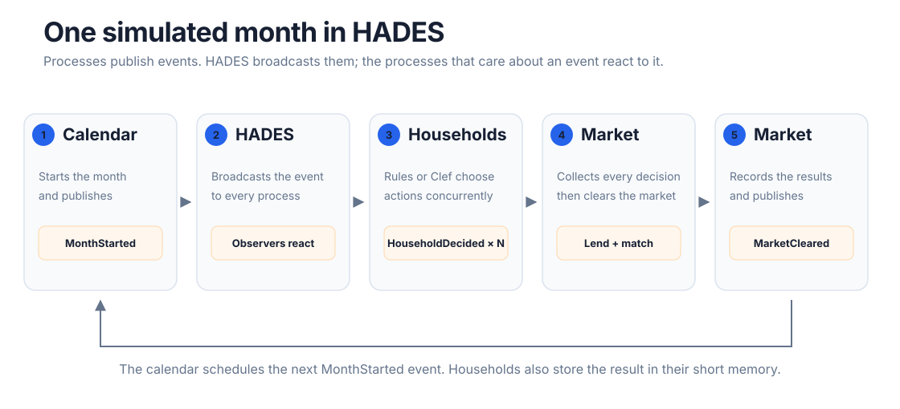
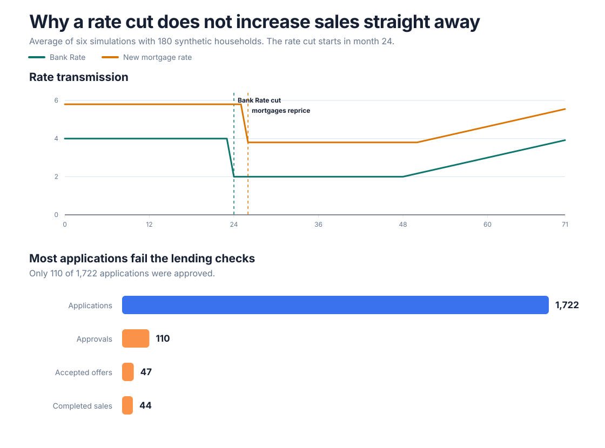
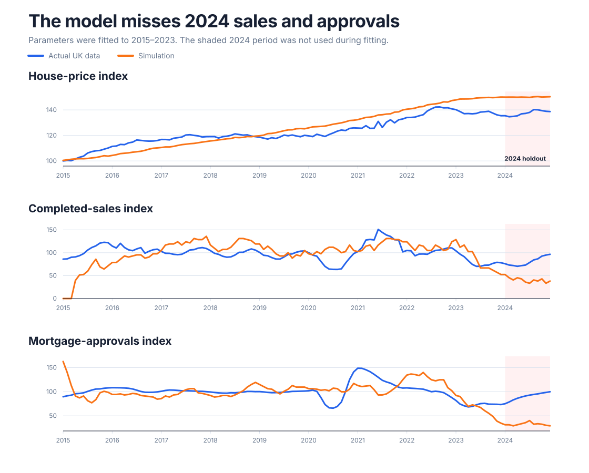
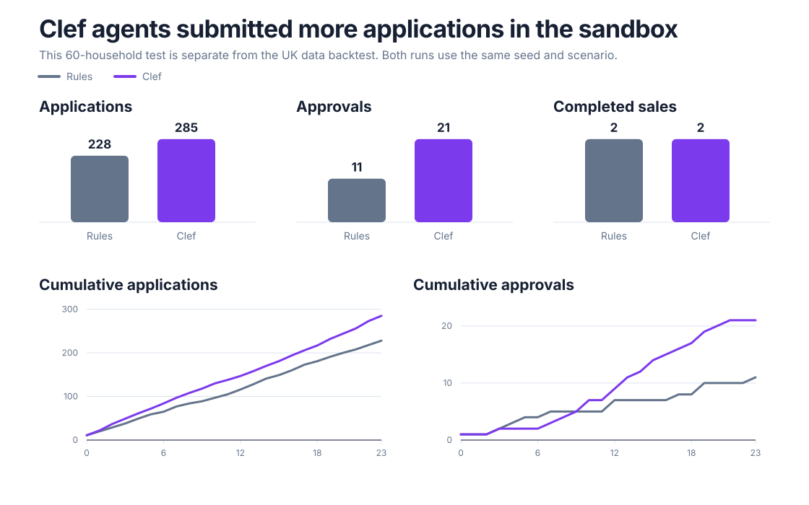

I wanted to learn how agent-based simulations work, and whether a decision model could replace one piece of the code. I built a small housing market with coded household rules, then swapped out one decision function.

What I did:

- Built a rule-based simulation where households decide whether to wait, buy, sell or become a landlord.
- Compared its output with UK price, sales and mortgage approval data. This was a basic check of the coded model, not a forecasting exercise.
- Ran a separate sandbox where Cloudflare Clef made the household decisions. Everything else stayed the same.

This is not a model of the whole UK housing market. It is a small engineering experiment using housing as the setting.

## Why use housing?

Housing has a manageable set of participants and rules. Households make choices, banks check affordability, buyers need a matching property, and accepted offers take time to complete. Rate changes affect each stage differently.

I used a [Bank of England agent-based model](https://www.bankofengland.co.uk/working-paper/2016/macroprudential-policy-in-an-agent-based-model-of-the-uk-housing-market) as a reference for household types and lending constraints. My much smaller version has synthetic renters, homeowners and landlords across London, the North West and the South East. It is not a reproduction of the Bank's model.

## One month in the simulation

I used [HADES](https://ki-oss.github.io/hades/api_reference/process/) to run the event loop. It works a bit like the observer pattern: processes publish events, and HADES broadcasts them to registered processes. This keeps the calendar, households and market separate.

The calendar publishes `MonthStarted`. Every household checks its finances, regional prices, mortgage rates and recent memory, then returns an action. In the first version that policy is Python rules. In the Clef version it is an API call.

Each household publishes `HouseholdDecided`. The market waits for every response, updates finances, completes purchases that are due, runs lending checks, matches buyers with listings and records the month. `MarketCleared` then starts the next month.

SimPy could handle the rule-based version. I chose HADES because it also runs household notifications concurrently, which helps once they include network calls to Clef.

The market rules still do most of the work. Choosing “buy” only starts an application. The bank checks the deposit, loan-to-value ratio, loan-to-income ratio and monthly repayment. The buyer still needs a listing and accepted offer; completion comes three months later and may fall through.

In the rate-cut scenario, Bank Rate falls in month 24 and mortgage pricing follows two months later. Across six-run averages, 1,722 applications became 110 approvals, 47 accepted offers and 44 completed sales. These are process counts from 180 synthetic households, not estimates of UK transaction volumes.

## Checking the coded model against UK data

Before adding Clef, I wanted to know how far the basic simulation was from real data. I used regional prices and completed sales from the [UK House Price Index](https://www.gov.uk/government/collections/uk-house-price-index-reports), plus Bank Rate and mortgage approvals from the [Bank of England database](https://www.bankofengland.co.uk/boeapps/database/).

I fitted five behaviour settings to monthly data from 2015 to 2023, including sensitivity to rates and excess demand. I kept 2024 out of the fitting process.

The model did not match 2024 particularly well. It overestimated house prices and underestimated both sales and mortgage approvals. Measured as root-mean-square error, the gaps were 12.7 index points for prices, 42.0 for sales and 58.1 for approvals.

I would not use it as a forecast. I kept it as a way to trace what happens inside the toy market when I change a lending rule or an interest-rate path.

## Replacing the coded decisions with Clef

The next experiment is separate from the backtest. I did not run Clef against the 2015–2024 UK series.

The original household policy converts a household's circumstances into fixed probabilities for the available actions. I replaced that policy with [Cloudflare Clef](https://developers.cloudflare.com/workers-ai/models/clef/). Clef is a decision model rather than a chatbot: it receives a description of the household and returns probabilities over the allowed actions. It cannot change balances, approve mortgages or invent prices.

I ran the same 60 synthetic households through the same 24-month rate-cut scenario twice. One run used the Python rules and the other used Clef. Both used the same starting state and random seed.

Clef produced 285 mortgage applications compared with 228 from the rules. Approvals increased from 11 to 21, but both runs completed two sales. Clef changed how often households tried to buy. The lending checks and available properties still limited what they could do.

This single run does not show that Clef behaves more like a real buyer. Testing that would need a larger population, many random seeds and another holdout comparison. The sandbox answers a smaller question: can I swap the decision policy without rewriting the rest of the simulation?

The policy swap worked without changing the market code. This was my first time using HADES and a hosted decision model. Clef was quick enough for the sandbox, but the weak baseline still matters more than the choice of decision policy.

[The code and saved results are on GitHub](https://github.com/connor-mcshane/uk-housing-lab).
